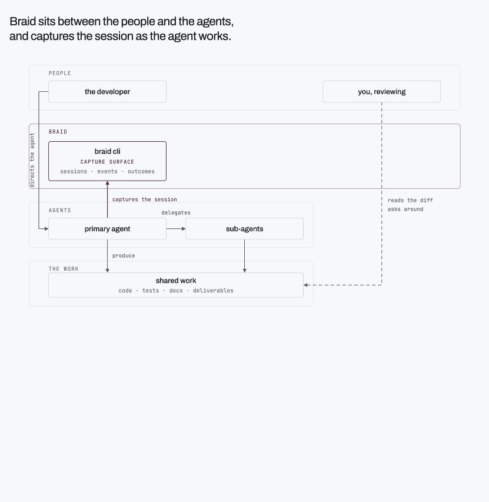
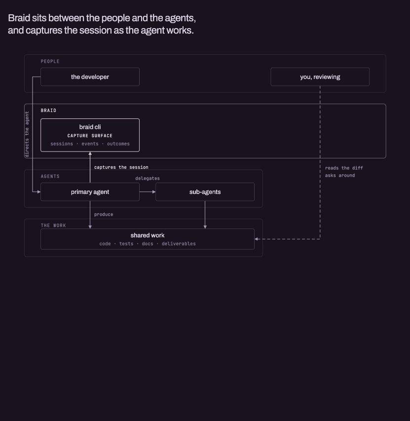
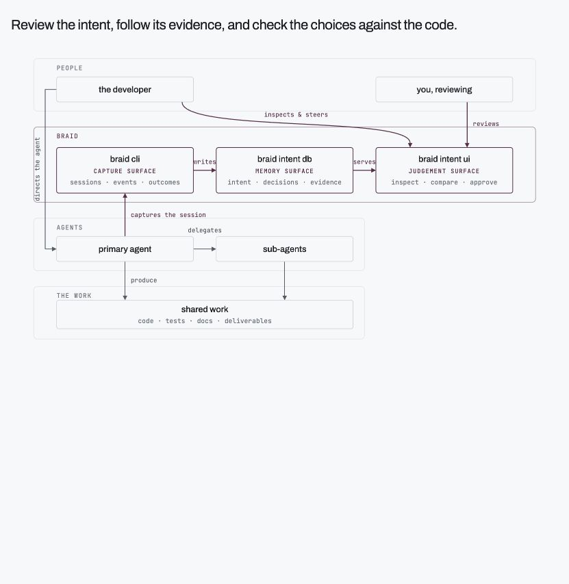
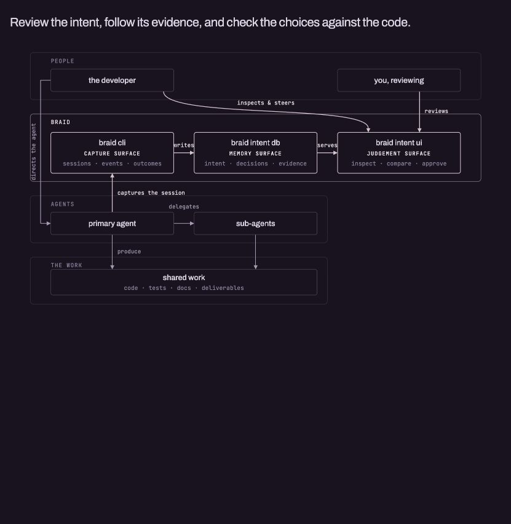
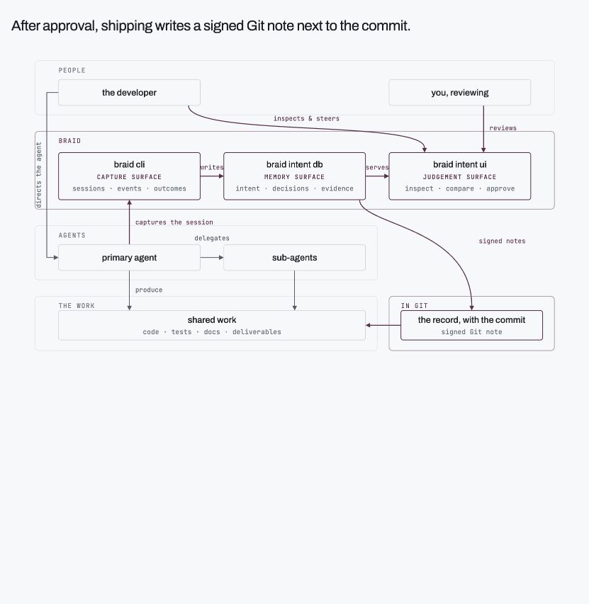
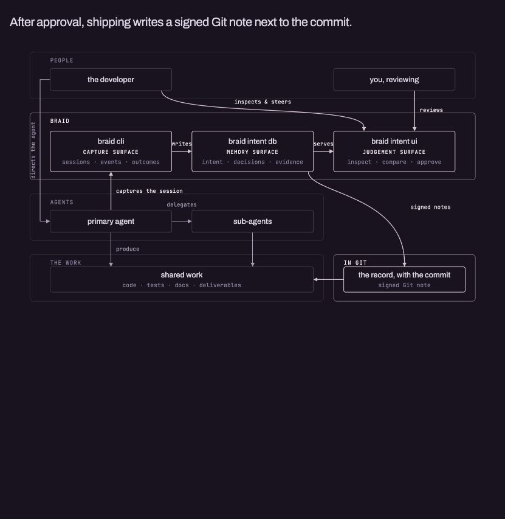

# Overview

Braid keeps the intent behind code written with an AI agent. It connects your
request, the work the agent did, the choices it made, and the checks it ran
to the code change you need to understand.

You keep working in your coding agent. Braid records the session. When the
change is ready, ask it to **reconstruct the intent** and review the result.

[Try it on BrewGo →](quickstart.md){ .md-button }

## Where Braid fits

Your request starts the work. An agent may delegate parts of it, change code,
run checks, and revise its approach. The final diff shows the code changes;
the session also contains the context behind them.

<figure class="braid-overview-figure">
  
  
  <figcaption>Braid records the work while you use your coding agent.</figcaption>
</figure>

## Review the work behind the change

Reconstruct the intent after the agent has finished and committed. Braid uses
the captured work and code changes to explain the goal, the outcome, the
decisions, and the steps that led there.

Open a decision to see the code it affected and the agent trace behind it.
Check the explanation against that evidence before you accept the change.

<figure class="braid-overview-figure">
  
  
  <figcaption>The intent gives you a starting point for checking what the agent did and why.</figcaption>
</figure>

| View | Use it to |
| --- | --- |
| **Overview** | Check that the goal and outcome match your request. |
| **Steps** | Follow the work, including checks and revisions, in order. |
| **Decisions** | Inspect choices, alternatives, and their effect on the code. |
| **Workstreams** | Follow the parent session and each captured subagent. |
| **Diagrams** | Understand how the changed parts fit together. |

If you would make a different choice, tell your agent what to change and why.
Have it commit, then reconstruct the same braid again. Review the updated
intent before moving on.

## Keep the record with the code

Approval records that you understood and accepted the intent. Shipping marks
the braid done and writes a signed Git note on the commit. A signature records
provenance; it does not establish that the code is correct.

<figure class="braid-overview-figure">
  
  
  <figcaption>Shipping keeps the final record beside the commit it explains.</figcaption>
</figure>

## What to expect in the preview

Braid supports macOS with Claude Code or Codex. This preview focuses on a
developer reviewing their own work. Team sharing is not part of this exercise.

The Review UI runs locally. Reconstruction sends captured requests, agent
replies, and code changes to Braid's hosted service, which uses a third-party
AI model. Braid does not currently redact that information automatically.
Use synthetic data for the sample and keep credentials out of agent messages.

The intent is reconstructed by a model. Use it to find the important code and
evidence, then make your own judgment.

## Choose your next step

- [Quickstart](quickstart.md): add a feature to BrewGo and review the agent's work.
- [Build and review](build-and-review.md): the planned expanded exercise, including a follow-up feature and the PR workflow.

Need help? Ask on [Discord](https://discord.gg/G3wzPsKtR) or email
[hello@braidkit.io](mailto:hello@braidkit.io).
