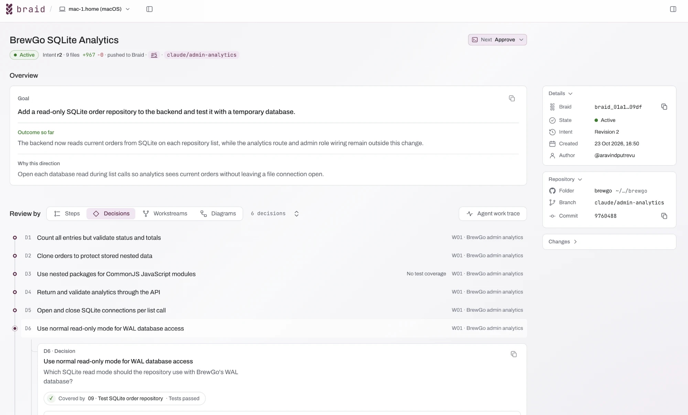
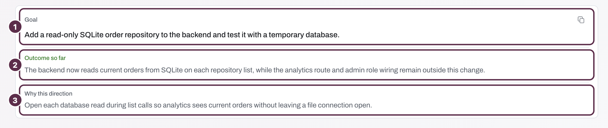
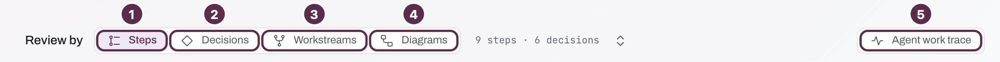
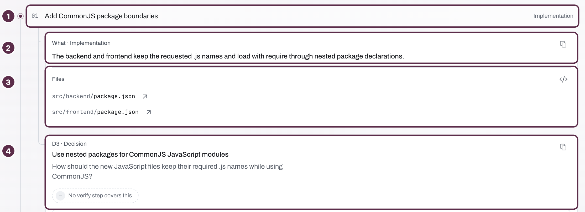
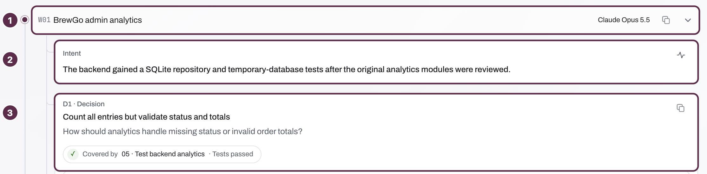
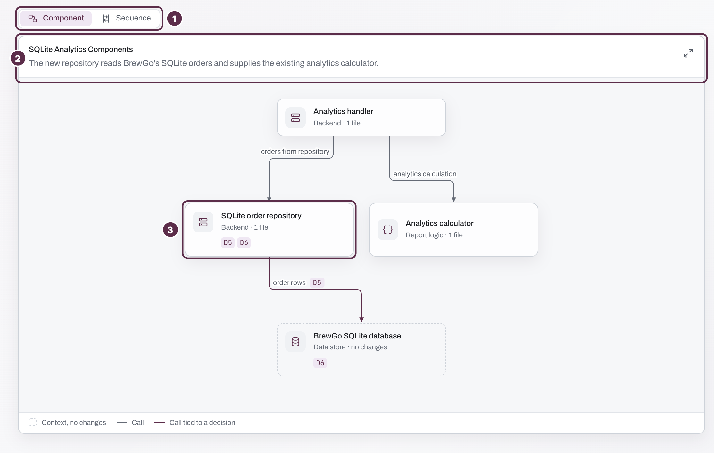
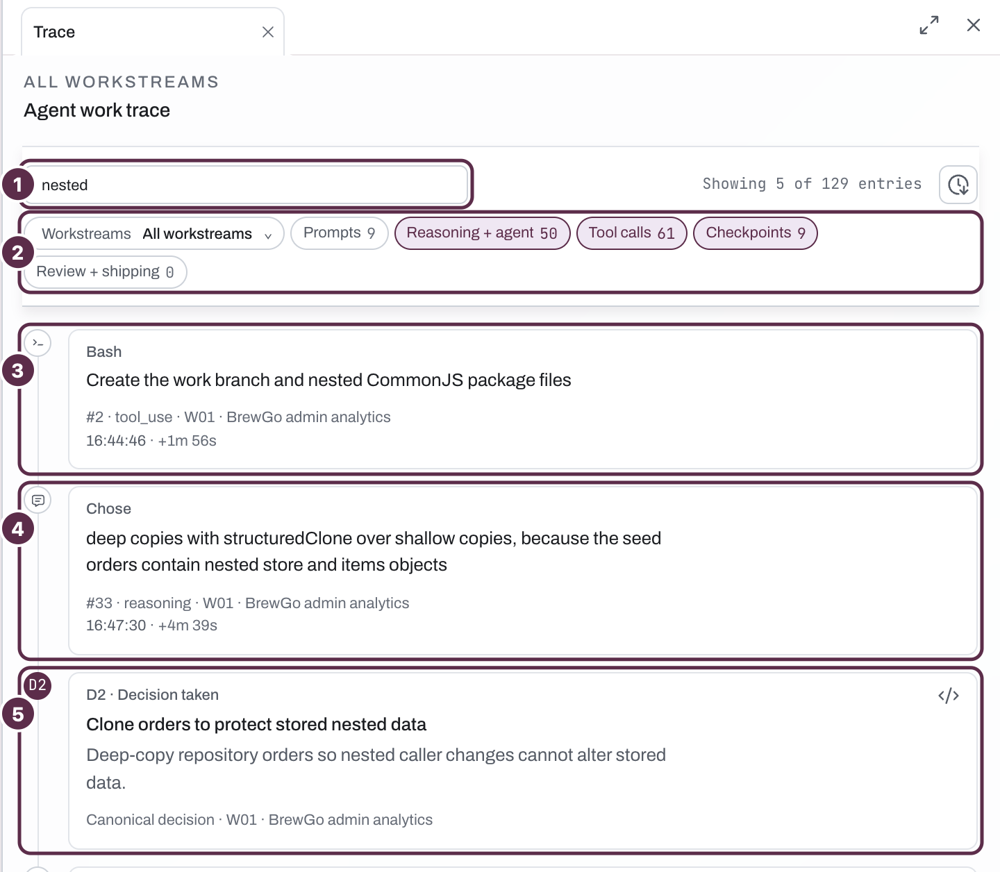
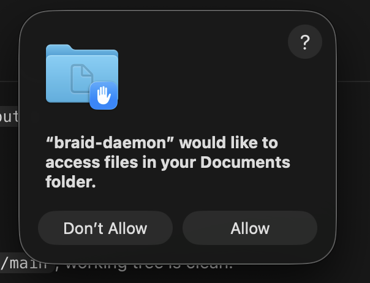

# Quickstart

[BrewGo](https://github.com/braidkit/brewgo) is a digital coffee shop like Starbucks. 

We are adding admin portal feature to [BrewGo](https://github.com/braidkit/brewgo) sample repository. Then use Braid to understand what your agent built,
check its choices, and direct a change before you open or merge a pull request.

Following `spec.md` in the repository, your agent adds an analytics module that reads those orders
without changing them, and a testable admin view. A parent agent gives each part to its own subagent. 

## Before you start

| You need | Notes |
| --- | --- |
| macOS and Git 2.25 or later | Braid's supported client platform. |
| Claude Code or Codex with subagent support | The spec uses a parent and two parallel subagents. |
| Node.js 22.13 or later | The analytics module reads SQLite with Node's built-in `node:sqlite`. |


## 1. Install Braid

```sh
curl -fsSL https://braidkit.io/cli/install.sh | bash
```

Follow the prompts to sign in with GitHub, add the Braid GitHub App and set up your coding agent.

[Screenshot-tktk]

The installer puts Braid in `~/.local/bin`.

Braid ambiently records AI Coding agent sessions automatically after installation setup. The coding sessions stay local. We will never be able to see them!

> In Codex Desktop, please trust all the hooks by going to Settings -> Hooks. In Codex CLI, run `/hooks` and approve Braid's hooks when prompted. 

## 2. Prepare BrewGo

In a terminal, clone BrewGo and create the feature branch **before starting the agent session**.


```sh
git clone https://github.com/braidkit/brewgo.git
cd brewgo
git switch -c feat/admin-analytics
```

## 3. Ask your agent to build the feature

Open a new coding agent session in this `brewgo` checkout. Then paste this prompt:

```text
use spec.md and start working on building the admin analytics dashboard feature.
```

Wait for the parent and both subagents to finish. 

## 4. Reconstruct the intent

You can reconstruct the intent in two ways: through Braid's skill in your agent,
or with the CLI.

=== "Skill"

    In the same coding agent session, send a new message:

    ```text
    reconstruct the intent
    ```

=== "CLI"

    In a terminal, in your `brewgo` checkout, run:

    ```sh
    braid intent
    ```

    Braid finds the captured work on the current branch and asks which prompt to
    include.

Braid opens the local intent review UI. 

[](assets/quickstart/review-ui-overview.webp)

## 5. Understand what the agent did through Braid

The Review UI shows the intent behind your change in three parts: the overview,
four ways to review the work, and the agent work trace. Watch a short tour, or
read about each part below.

<video controls muted playsinline preload="metadata" width="1438" height="856"
  poster="../assets/quickstart/review-ui-walkthrough-poster.jpg"
  aria-label="A walkthrough of the Braid Review UI: the overview, the steps, the decisions, the workstreams, the diagrams, and the code behind a decision.">
  <source src="../assets/quickstart/review-ui-walkthrough.mp4" type="video/mp4">
</video>

### The overview: your intent

[](assets/quickstart/review-ui-intent.png)

1. **Goal:** what you and your agent set out to change.
2. **Outcome so far:** what the agent delivered, and what stays outside the
   change.
3. **Why this direction:** the direction that the agent took, and why.

Does the goal match your request? Does the outcome match with what you are
thinking?

### Review by: four views of one change

[](assets/quickstart/review-ui-review-by.png)

Each view shows the same change from another angle: the steps (1), the
decisions (2), each agent's work (3), and diagrams (4). The agent work trace (5)
shows the record behind all of them.

=== "Steps"

    [](assets/quickstart/review-ui-steps.png)

    1. **The step:** what the agent did, in order, and the kind of work, such as
       Implementation.
    2. **What:** a summary of the step.
    3. **Files:** the files that the step changed. Select `</>` to see the code.
    4. **The decision** that the step carried out, and whether a check covers
       it.

=== "Decisions"

    [](assets/quickstart/review-ui-decision.png)

    Every decision has the same four parts. In this run, decision `D6` is about
    how the analytics module opens BrewGo's SQLite database. Your agent makes
    its own decisions, so yours can differ.

    1. **The question** that the agent had to answer. Did your change need this
       question answered?
    2. **The evidence:** the recorded check that covers the decision, and its
       result. Here, the SQLite repository tests passed. When Braid shows no
       test coverage for a decision, read the code yourself.
    3. **The chosen approach**, and why the agent took it. Select `</>` to see
       the code behind it.
    4. **The other approaches** that the agent considered, and why it did not
       take them. Here, immutable mode could miss orders that are still in the
       write-ahead log.

=== "Workstreams"

    [](assets/quickstart/review-ui-workstreams.png)

    1. **The workstream:** one agent's part of the work, such as a parent agent
       or one of its subagents, and the model that did it.
    2. **Its intent:** what this part of the work achieved.
    3. **Its decisions**, in the same form as in Decisions.

=== "Diagrams"

    [](assets/quickstart/review-ui-diagrams.png)

    1. **Component or Sequence:** see how the parts of the change fit together,
       or the order in which they call each other.
    2. **The summary:** what the change does to the system.
    3. **A component** that the change adds or uses. Its labels, such as `D5`
       and `D6`, link it to the decisions about it.

### The agent work trace

[](assets/quickstart/review-ui-trace.png)

1. **Search** the trace. Here, "nested" finds the entries about the nested
   package files.
2. **Filter** by workstream, and by kind: prompts, reasoning, tool calls,
   checkpoints, and review.
3. **A tool call**, such as a shell command, with its time.
4. **The agent's reasoning** for a choice.
5. **A checkpoint**, such as a decision that the agent took.

If you would choose differently, tell your agent which approach to take and why using the copy button. 

## 6. Share the Intent with your peers

You cannot push to `braidkit/brewgo`, so your pull request opens in a repository
of your own. You can share the intent in two ways: through Braid's skills in your
agent, or with the CLI.

=== "Skill"

    In the same coding agent session, ask:

    ```text
    create a private brewgo repository on my GitHub account, make it origin, push main, then push and raise a PR
    ```

    Your agent creates the repository with its own GitHub tools, usually the
    GitHub CLI, and points `origin` at it. Then it pushes the branch and opens
    the pull request. Braid's skills push the braid, link it to the pull request,
    and comment the intent on the PR, so your peers can read the intent where
    they review the code.

=== "CLI"

    With the [GitHub CLI](https://cli.github.com), create the repository, push
    both branches, and open the pull request:

    ```sh
    git remote remove origin
    gh repo create brewgo --private --source=. --remote=origin
    git push -u origin main
    git push -u origin feat/admin-analytics
    gh pr create --base main --fill
    ```

    Then push the braid with its ID from step 4, and the pull request number and
    URL that `gh pr create` printed. Always pass both:

    ```sh
    braid push <braid-id> --pr-number <number> --pr-url <url>
    ```

    To upload the intent without a pull request, run `braid push <braid-id>`.

Braid comments on a pull request when the Braid GitHub App is installed on its
repository. If you installed the App for selected repositories only, add your new
`brewgo` repository in the [Braid App's settings](https://github.com/apps/braidkit/installations/new).

## Troubleshooting

### Agent permissions

Braid's skills run `braid` through your agent. If your agent runs commands in a sandbox, as Codex does by
default and Claude Code does once you turn its sandbox on, the sandbox needs
network access and local binding. Without them, Braid can say you're signed out
or that the daemon isn't running when neither is true. Allow both in whichever
way suits you. Approving your agent's request to run `braid` outside the
sandbox works too.

### macOS folder access

If your repository is in Desktop, Documents, Downloads or iCloud Drive, macOS
asks whether `braid-daemon` can access that folder. Allow it, because Braid
reads your repository from there. If you chose **Don't Allow**, turn it back
on in **System Settings > Privacy & Security > Files & Folders**.

{ width="302" }

### Update Braid

Braid doesn't update itself, and an outdated install can fail to reconstruct
the intent.

```sh
braid upgrade
```

### Stop or remove Braid

To stop recording, run `braid hooks uninstall claude` or
`braid hooks uninstall codex`. To remove Braid, run `braid uninstall`.

## Need help?

Ask your agent "is Braid set up correctly?" if setup or recording looks wrong.

Ask on [Discord](https://discord.gg/G3wzPsKtR) or email
[hello@braidkit.io](mailto:hello@braidkit.io).
